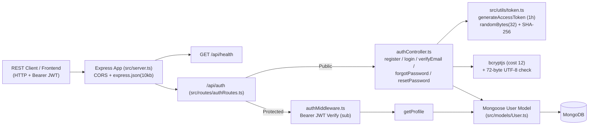

# Secure-Auth-System


-blue?style=flat-square)

> TypeScript & Express REST API implementing stateless JWT authentication, salted `bcryptjs` password hashing, SHA-256 hashed single-use email verification tokens, and enumeration-safe password reset flows backed by MongoDB.

---

## Table of Contents

- [Project Introduction](#project-introduction)
- [Problem Statement](#problem-statement)
- [Project Objectives](#project-objectives)
- [Key Features](#key-features)
- [Technology Stack](#technology-stack)
- [Screenshots](#screenshots)
- [Architecture Diagram](#architecture-diagram)
- [Application Workflow](#application-workflow)
- [Project Directory Structure](#project-directory-structure)
- [Database Design](#database-design)
- [API Documentation](#api-documentation)
- [Installation Instructions](#installation-instructions)
- [Environment Variables](#environment-variables)
- [How to Run Locally](#how-to-run-locally)
- [Usage Examples & Real-World Scenarios](#usage-examples--real-world-scenarios)
- [Testing Instructions & Results](#testing-instructions--results)
- [Deployment Instructions](#deployment-instructions)
- [Security Considerations](#security-considerations)
- [Future Improvements](#future-improvements)
- [Contribution Guidelines](#contribution-guidelines)
- [License](#license)
- [Author](#author)

---

## Project Introduction

**Secure-Auth-System** is a standalone TypeScript authentication microservice built with Express and Mongoose. Rather than storing plaintext verification codes or relying on ad-hoc password checks, it separates user identity, password storage, and cryptographic lifecycle tokens (email verification and password recovery) with strict input validation and non-leaky error responses.

---

## Problem Statement

Authentication backends frequently fail security audits due to predictable implementation mistakes:

1. **Token Storage Exposure:** Persisting raw email-verification or password-reset tokens in the database allows account takeover if read access to the database is compromised.
2. **Account Enumeration:** Returning distinct HTTP messages such as `"Email not found"` on password reset or login leaks registered email addresses.
3. **Bcrypt Silent Truncation:** Passwords longer than 72 UTF-8 bytes are silently truncated by standard bcrypt implementations unless explicitly rejected.
4. **Weak Signing Secrets:** Running JWT verification with short or missing environment secrets undermines token integrity.

---

## Project Objectives

- Implement a clean TypeScript + Express authentication service under strict compiler checking (`"strict": true` in `tsconfig.json`).
- Enforce strong credential handling using `bcryptjs` (cost factor `12`), 72-byte UTF-8 boundary checks, and `select: false` password projection in Mongoose.
- Secure verification and password-reset flows using `crypto.randomBytes(32)` tokens stored exclusively as SHA-256 digests with 15-minute expiration windows.
- Protect authenticated routes with `Bearer` JWT middleware enforcing a minimum 32-character `JWT_SECRET`.

---

## Key Features

- **User Registration (`POST /api/auth/register`):** Validates name (`2–100` chars), normalized lowercase email, and strong password rules (enforcing 72-byte UTF-8 max length and complexity) before hashing with `bcryptjs` (salt rounds `12`).
- **SHA-256 Token Persistence:** Generates cryptographically random 32-byte hex tokens (`generateRandomToken`) and persists only SHA-256 hashes (`hashToken`) with a 15-minute TTL for both email verification and password reset.
- **Email Verification (`GET /api/auth/verify-email/:token`):** Verifies non-expired hashed tokens, marks `isVerified: true`, and clears used token metadata.
- **Account-Enumeration-Safe Password Recovery (`POST /api/auth/forgot-password` & `POST /api/auth/reset-password/:token`):** Always returns a generic success message regardless of whether the submitted email exists, and invalidates reset tokens immediately after password update.
- **Stateless Protected Profile (`GET /api/auth/profile`):** Extracts `Authorization: Bearer <token>`, validates the HMAC-signed JWT `sub` claim in `authenticate` middleware, and returns user profile fields without password or token hashes.
- **Health Check & Payload Guard:** Exposes `GET /api/health` and constrains JSON request bodies to `10kb` via `express.json({ limit: "10kb" })`.

---

## Technology Stack

| Layer | Technology | Version (`package.json`) | Purpose |
| --- | --- | --- | --- |
| Language | TypeScript | `5.9.3` | Strict static typing (`target: ES2020`, `module: CommonJS`) |
| Web Framework | Express | `^4.21.2` | REST routing, `10kb` JSON body limit |
| ODM & Database | Mongoose / MongoDB | `^8.9.5` | Schema validation, unique email index, timestamps |
| Password Hashing | `bcryptjs` | `^2.4.3` | Adaptive password hashing (`12` salt rounds) |
| Access Tokens | `jsonwebtoken` | `^9.0.2` | Signed JWT generation (`sub`, `1h` expiry) and verification |
| Cryptography | Node `crypto` (built-in) | Node runtime | `randomBytes(32)` token generation & SHA-256 hashing |
| Email Library | `nodemailer` | `^6.10.0` | Declared dependency for SMTP delivery integration |
| Cross-Origin & Config | `cors`, `dotenv` | `^2.8.5`, `^16.4.7` | CORS headers and `.env` variable loading |
| Development Runner | `ts-node-dev` | `^2.0.0` | Hot-reloading TypeScript execution |

---

## Screenshots

No UI screenshots or Postman collection exports are committed to this repository (API-only backend service). Live endpoint verification can be performed locally using `curl`, Postman, or Insomnia against `http://localhost:5000/api/auth/*`.

---

## Architecture Diagram



---

## Application Workflow

1. **Client Registration:** `POST /api/auth/register` validates inputs, verifies email uniqueness, hashes the password with `bcryptjs`, stores a SHA-256 digest of a 32-byte verification token (`15m` expiry), and (in non-production mode) logs the verification token to stdout for development testing.
2. **Email Confirmation:** Calling `GET /api/auth/verify-email/:token` hashes `:token` with SHA-256, matches `verificationTokenHash` + `verificationTokenExpires > now`, sets `isVerified = true`, and clears the token fields.
3. **Authentication:** `POST /api/auth/login` explicitly selects `+password` (overriding `select: false`), verifies `bcryptjs.compare`, enforces `isVerified === true`, and returns a `1h` JWT issued by `generateAccessToken(userId)`.
4. **Password Reset:** `POST /api/auth/forgot-password` generates and hashes a single-use reset token (`15m` expiry) without disclosing whether the account exists; `POST /api/auth/reset-password/:token` verifies the hashed token, updates the hashed password, and clears `resetTokenHash`/`resetTokenExpires`.
5. **Authenticated Requests:** `GET /api/auth/profile` passes through `authenticate` middleware, which verifies the `Authorization: Bearer <token>` signature against `JWT_SECRET` (`>= 32` chars) and populates `req.userId = decoded.sub`.

---

## Project Directory Structure

Tracked files in the repository (`git ls-files`):

```text
Secure-Auth-System/
├── .gitignore                 # Excludes node_modules/, dist/, .env, .env.*, logs, OS/editor artifacts
├── README.md                  # Project documentation
├── package.json               # Scripts (dev, build, start) and dependencies (MIT license)
├── package-lock.json          # Dependency lockfile
├── tsconfig.json              # Strict CommonJS TypeScript configuration (src -> dist)
└── src/
    ├── server.ts              # Express bootstrap, CORS, 10kb JSON limit, /api/health, /api/auth
    ├── config/
    │   └── database.ts        # Mongoose connection helper requiring MONGODB_URI
    ├── controllers/
    │   └── authController.ts  # Registration, login, email verification, forgot/reset password, profile
    ├── middleware/
    │   └── authMiddleware.ts  # Bearer JWT verification and 32-char JWT_SECRET enforcement
    ├── models/
    │   └── User.ts            # Mongoose IUser schema (email unique, password select:false, token hashes)
    ├── routes/
    │   └── authRoutes.ts      # /api/auth/* route bindings
    └── utils/
        └── token.ts           # JWT signing (1h expiry), crypto.randomBytes(32), SHA-256 hashing
```

---

## Database Design

MongoDB collection backed by the Mongoose `User` schema (`src/models/User.ts`, with `{ timestamps: true }`):

| Field | Type | Constraints / Default | Purpose |
| --- | --- | --- | --- |
| `_id` | `ObjectId` | Auto-generated primary key | User identifier encoded in JWT `sub` claim |
| `name` | `String` | `required`, `trim`, `minlength: 2`, `maxlength: 100` | Display / account holder name |
| `email` | `String` | `required`, `unique: true`, `lowercase: true`, `trim: true` | Unique login identifier |
| `password` | `String` | `required`, `select: false` | `bcryptjs` hash (excluded from queries by default) |
| `isVerified` | `Boolean` | Default: `false` | Gates login until email verification succeeds |
| `verificationTokenHash` | `String` | Optional | SHA-256 hex digest of active email verification token |
| `verificationTokenExpires` | `Date` | Optional | Expiration timestamp (`now + 15 minutes`) |
| `resetTokenHash` | `String` | Optional | SHA-256 hex digest of active password reset token |
| `resetTokenExpires` | `Date` | Optional | Expiration timestamp (`now + 15 minutes`) |
| `createdAt` / `updatedAt` | `Date` | Auto-managed (`timestamps: true`) | Audit timestamps |

---

## API Documentation

Base URL (local): `http://localhost:5000`

### Health Check

| Method | Endpoint | Auth | Response |
| --- | --- | --- | --- |
| `GET` | `/api/health` | Public | `200 OK` `{ "success": true, "message": "Secure Authentication API is running" }` |

### Authentication Endpoints (`/api/auth`)

| Method | Endpoint | Auth | Request / Parameters | Key Behavior |
| --- | --- | --- | --- | --- |
| `POST` | `/api/auth/register` | Public | JSON `{ name, email, password }` | Validates fields & 72-byte cap; hashes password; creates `unverified` user + verification hash |
| `POST` | `/api/auth/login` | Public | JSON `{ email, password }` | Verifies `bcryptjs` hash & `isVerified`; returns JWT access token (`1h`) |
| `GET` | `/api/auth/verify-email/:token` | Public | Route param `:token` | Hashes token, validates expiry, sets `isVerified: true`, clears token fields |
| `POST` | `/api/auth/forgot-password` | Public | JSON `{ email }` | Enumeration-safe response; generates `15m` SHA-256 reset token hash if user exists |
| `POST` | `/api/auth/reset-password/:token` | Public | Param `:token` + JSON `{ password }` | Validates hashed reset token & expiry; updates password hash; clears reset fields |
| `GET` | `/api/auth/profile` | Bearer JWT | Header `Authorization: Bearer <token>` | Protected by `authenticate`; returns authenticated user profile |

---

## Installation Instructions

### Prerequisites

- **Node.js** `v18+` (or `v20+` LTS) and **npm**
- Running **MongoDB** instance (local MongoDB Community Server or MongoDB Atlas URI)

### Setup

```bash
git clone https://github.com/mohan5535/Secure-Auth-System.git
cd Secure-Auth-System
npm install
```

Create a local `.env` file in the repository root (note: `.gitignore` ignores `.env` and `.env.*`, and no `.env.example` template is currently committed in the repository):

```dotenv
PORT=5000
NODE_ENV=development
MONGODB_URI=mongodb://127.0.0.1:27017/secure_auth_db
JWT_SECRET=<replace-with-at-least-32-random-characters>
```

---

## Environment Variables

Variables read directly from `process.env` in `src/`:

| Variable | Referenced In | Required | Default / Constraint | Notes |
| --- | --- | --- | --- | --- |
| `PORT` | `src/server.ts` | Optional | `5000` | HTTP port bound by Express |
| `MONGODB_URI` | `src/config/database.ts` | **Yes** | Throws if missing | MongoDB connection string |
| `JWT_SECRET` | `src/utils/token.ts`, `src/middleware/authMiddleware.ts` | **Yes** | Minimum `32` characters | Used to sign and verify HS256 JWTs |
| `NODE_ENV` | `src/controllers/authController.ts` | Optional | Standard Express env | When not `"production"`, verification/reset tokens are logged to server console for local testing |

> **Implementation Note:** Although `src/utils/token.ts` enforces `"1h"` token expiry directly (`{ expiresIn: "1h" }`), no `JWT_EXPIRES_IN` override is currently read from `process.env`. Keep `JWT_SECRET` out of version control.

---

## How to Run Locally

```bash
# Development server with hot reload (ts-node-dev)
npm run dev

# Or compile TypeScript to dist/ and run production build
npm run build
npm start
```

Verify the server is running:

```bash
curl http://localhost:5000/api/health
```

---

## Usage Examples & Real-World Scenarios

### Scenario 1: End-to-End API Registration, Verification & Session Access

Suitable for SPAs or backend services delegating identity management via stateless JWTs:

```bash
# 1. Register user (logs verification token to server console in non-production mode)
curl -X POST http://localhost:5000/api/auth/register \
  -H "Content-Type: application/json" \
  -d '{"name":"Mohan Mandal","email":"mohan@example.com","password":"StrongPass#2026"}'

# 2. Activate account using the 64-char hex verification token
curl http://localhost:5000/api/auth/verify-email/<RAW_VERIFICATION_TOKEN>

# 3. Log in to receive a signed 1-hour JWT access token
curl -X POST http://localhost:5000/api/auth/login \
  -H "Content-Type: application/json" \
  -d '{"email":"mohan@example.com","password":"StrongPass#2026"}'

# 4. Access authenticated profile
curl http://localhost:5000/api/auth/profile \
  -H "Authorization: Bearer <ACCESS_TOKEN>"
```

### Scenario 2: Enumeration-Safe Self-Service Password Recovery

When a user forgets credentials, `POST /api/auth/forgot-password` issues the same generic `200 OK` message whether the email exists or not, persisting only a 15-minute SHA-256 hash (`resetTokenHash`) for real accounts before `POST /api/auth/reset-password/:token` rotates the `bcryptjs` password hash and clears the reset fields.

---

## Testing Instructions & Results

- **Current Automated Test Coverage:** `package.json` defines `dev`, `build` (`tsc`), and `start` scripts; there is **no `"test"` script or automated test suite** (unit or integration) committed to this repository yet.
- **Do Not Extrapolate Coverage:** No automated test pass counts are claimed because no test runner is present in `package.json`.
- **Manual Smoke Verification Flow:** With MongoDB running and `.env` configured (`NODE_ENV=development`), exercise the endpoints sequentially via `curl` or Postman:
  1. `GET /api/health` -> verify `200 OK`
  2. `POST /api/auth/register` -> read development verification token from server console
  3. `GET /api/auth/verify-email/:token` -> confirm user activation
  4. `POST /api/auth/login` -> copy returned JWT
  5. `GET /api/auth/profile` with `Authorization: Bearer <jwt>` -> confirm `200 OK`
  6. `POST /api/auth/forgot-password` + `POST /api/auth/reset-password/:token` -> confirm password update

---

## Deployment Instructions

1. Provision a managed Node.js service (Render, Railway, Fly.io, or VPS) and a MongoDB Atlas cluster.
2. Configure environment variables (`PORT`, `NODE_ENV=production`, `MONGODB_URI`, and a cryptographically random `JWT_SECRET` of at least 32 characters).
3. Run the TypeScript build step and start the compiled server:

```bash
npm ci
npm run build
npm start
```

4. Ensure `cors()` in `src/server.ts` is restricted to your production frontend origin before exposing the API publicly, and wire a real SMTP transport using the installed `nodemailer` package because `NODE_ENV=production` suppresses console token logging.

---

## Security Considerations

- **Strengths Implemented in Code:**
  - `bcryptjs` password hashing with salt rounds `12` and explicit 72-byte UTF-8 password length validation.
  - Double-hashed token protection: raw 32-byte tokens are returned/dispatched out-of-band while only SHA-256 digests (`verificationTokenHash`, `resetTokenHash`) and 15-minute expiry dates are persisted.
  - `password` schema field uses `select: false` so user queries never leak password hashes unintentionally.
  - Enumeration-safe `forgotPassword` response prevents attackers from probing registered emails.
  - `express.json({ limit: "10kb" })` limits JSON payload flood attacks, and `JWT_SECRET` length `< 32` is rejected at runtime.
- **Remaining Risks / Hardening Backlog Identified During Inspection:**
  - `nodemailer` (`^6.10.0`) is listed in `package.json`, but SMTP transport dispatch is not yet wired in `src/controllers/authController.ts` (currently logs tokens to stdout when `NODE_ENV !== "production"`).
  - `app.use(cors())` in `src/server.ts` allows unrestricted origins by default; restrict `origin` before production use.
  - HTTP rate limiting (`express-rate-limit`), security headers (`helmet`), and refresh-token rotation/revocation are not yet implemented.

---

## Future Improvements

1. Wire `nodemailer` SMTP transport (using `SMTP_HOST`, `SMTP_PORT`, `SMTP_USER`, `SMTP_PASS`) in `authController.ts` for production verification and password-reset emails.
2. Add an automated Jest or Vitest + Supertest integration suite (backed by `mongodb-memory-server`) plus a root `.env.example` template.
3. Add `helmet`, strict origin-allowlisted `cors()`, and route-specific rate limiting on `/login`, `/register`, and `/forgot-password`.
4. Read `JWT_EXPIRES_IN` dynamically in `src/utils/token.ts` and add a root `LICENSE` file matching `package.json`.

---

## Contribution Guidelines

1. Fork the repository and create a feature branch (`git checkout -b feat/your-feature`).
2. Keep TypeScript strict-mode clean (`npm run build` must succeed with zero compiler errors).
3. Never commit `.env` files, database credentials, or real secrets.
4. Open a pull request describing the change, affected endpoints, and verification steps performed.

---

## License

Declared as **`MIT`** in `package.json` (`"license": "MIT"`). Note that a standalone root `LICENSE` file is not currently committed in the repository.

---

## Author

- **Mohan** — GitHub: [@mohan5535](https://github.com/mohan5535)
- Repository: [mohan5535/Secure-Auth-System](https://github.com/mohan5535/Secure-Auth-System)
